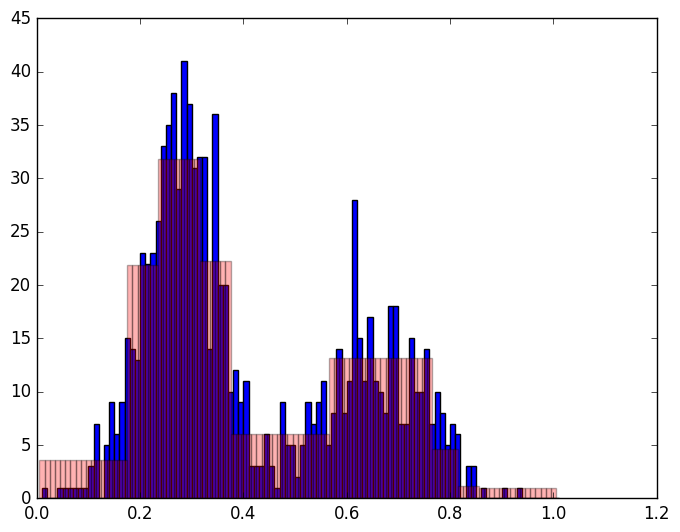

# PrivateMultiplicativeWeights.jl

[](https://github.com/mrtzh/PrivateMultiplicativeWeights.jl/actions/workflows/CI.yml)

PrivateMultiplicativeWeights.jl implements the Multiplicative Weights with
Exponential Mechanism (MWEM) algorithm for differentially private synthetic
data release. It supports explicit histograms, binary tabular data, range
queries, parity workloads for marginals, and a factored approximation for
higher-dimensional binary data.

The package requires Julia 1.10 or newer. CI tests the oldest supported Julia
minor and the latest stable Julia 1.x release on Linux, macOS, and Windows.

## Installation

PrivateMultiplicativeWeights.jl is not currently registered in Julia's General
registry. Install it directly from GitHub instead:

```julia
using Pkg
Pkg.add(url="https://github.com/mrtzh/PrivateMultiplicativeWeights.jl")
```

Then load it with:

```julia
using PrivateMultiplicativeWeights
```

## Quick start

The following example approximates a four-bin histogram while answering all
prefix queries. A directly constructed `Histogram` must include the number of
source records because MWEM uses it to calibrate noise.

```julia
using PrivateMultiplicativeWeights
using Random

Random.seed!(42)

counts = [5, 15, 60, 20]
data = Histogram(counts, sum(counts))
workload = SeriesRangeQueries(length(counts))
parameters = MWParameters(epsilon=1.0, iterations=10)

result = mwem(workload, data, parameters)
result.synthetic.weights
```

A representative histogram approximation looks like this:



See the [histogram example notebook](examples/histograms.ipynb) for the full
walkthrough.

`result.synthetic` is the normalized synthetic representation. For explicit
histograms, it can be sampled back into binary columns:

```julia
synthetic_table = Tabular(result.synthetic, 1_000)
```

## Binary tabular data and marginals

`Tabular` stores a `d × n` matrix: rows are binary attributes and columns are
records. `Parities(d, k)` constructs the Fourier workload needed to preserve
all `k`-way marginals and converts the table to an explicit histogram of length
`2^d`.

```julia
using PrivateMultiplicativeWeights
using Random

Random.seed!(42)
d, n = 8, 1_000
matrix = rand(0:1, d, n)
matrix[3, :] .= matrix[1, :] .* matrix[2, :]

result = mwem(
    Parities(d, 3),
    Tabular(matrix),
    MWParameters(epsilon=2.0, iterations=20),
)

three_way_marginals = Marginals(Parities(d, 3), result.synthetic)
```

For larger `d`, an explicit `2^d` histogram quickly becomes impractical. The
factored workload keeps product distributions over groups of attributes and
merges groups when selected queries require it:

```julia
d, n = 100, 1_000
matrix = rand(0:1, d, n)
matrix[3, :] .= matrix[1, :] .* matrix[2, :]

result = mwem(
    FactorParities(d, 3),
    Tabular(matrix),
    MWParameters(epsilon=2.0, iterations=20),
)
```

Factored histograms are a scalable approximation. They do not currently
support `noisy_init=true`; requesting it raises an `ArgumentError`.

## Privacy model

`epsilon` controls the privacy budget used by each MWEM iteration. Within an
iteration, `noisy_max_budget` divides that budget between private query
selection and measuring the selected query. Replaying previously released
measurements through multiplicative-weights updates is post-processing, so
`repetitions` adds no privacy cost.

When `noisy_init=true`, `init_budget` allocates part of `epsilon` to private
histogram initialization and the remainder to the iterations. The package does
not provide a privacy accountant across iterations or multiple invocations;
callers are responsible for applying the composition theorem appropriate to
their use case.

The following operations inspect the source data or exact answers and are
therefore **not differentially private**:

- setting `verbose=true`;
- `maximum_error(result)`;
- `mean_squared_error(result)`;
- `kl_divergence_error(result)`.

Do not publish their output unless that disclosure has been separately
accounted for.

## Parameters

Construct `MWParameters` with any subset of these keyword arguments:

| Name | Default | Meaning |
| --- | ---: | --- |
| `epsilon` | `1.0` | Positive privacy parameter used by initialization and each iteration. |
| `iterations` | `10` | Number of private selection-and-measurement iterations. |
| `repetitions` | `10` | Extra post-processing passes over already measured queries. |
| `noisy_init` | `false` | Use a private data-dependent histogram initialization. Explicit histograms only. |
| `verbose` | `false` | Print exact, non-private error and timing information. |
| `init_budget` | `0.05` | Fraction of `epsilon` assigned to noisy initialization. Must be in `[0, 1)` and positive when enabled. |
| `noisy_max_budget` | `0.5` | Fraction of each iteration assigned to query selection. Must be in `(0, 1)`. |

Invalid budgets, negative iteration counts, non-finite values, and unsupported
combinations fail immediately with `ArgumentError`.

## Data representations

### `Histogram(weights, num_samples=0)`

Stores nonnegative finite weights over a finite domain. Construction does not
normalize the weights; `mwem` normalizes a private copy and does not mutate the
caller's histogram. `num_samples` must be positive when the histogram is used as
private input to `mwem`.

Sampling a histogram with `Tabular(histogram, n)` requires its length to be a
power of two because each domain element is decoded as a binary vector.

### `Tabular(matrix)`

Stores finite values in a `d × n` floating-point matrix. Conversion to a
histogram and all built-in parity workloads require values to be exactly zero
or one. Custom query implementations may use other finite values.

## Query workloads

### `HistogramQueries(query_matrix)`

Represents arbitrary linear queries. For a histogram with `N` bins and `k`
queries, `query_matrix` has shape `N × k`; each column is one query.

### `SeriesRangeQueries(N)`

Represents the `N` prefix queries `[1:1], [1:2], …, [1:N]`.
`queriesMatrix(workload)` returns the equivalent `N × N` matrix accepted by
`HistogramQueries`.

### `RangeQueries(intervals, N)` and `RangeQuery(interval, N)`

Represent arbitrary inclusive intervals `(start, stop)` satisfying
`1 <= start <= stop <= N`.

### `Parities(d, k)`

Represents the Fourier coefficients sufficient to reconstruct all `k`-way
marginals of `d` binary attributes. This workload uses an explicit histogram
with `2^d` entries.

### `FactorParities(d, k)`

Represents parity queries of orders one through `k` over a factored histogram.
It avoids allocating the complete `2^d` domain but may merge factors and grow
as correlations are learned.

## Results and diagnostics

`mwem` returns an `MWState`. Its most useful fields are:

- `result.synthetic`: the synthetic `Histogram` or internal factored
  representation;
- `result.measurements`: the private noisy answers selected during the run;
- `result.scale`: the base Laplace-noise scale.

Diagnostics compare `result.synthetic` against exact workload answers retained
in the state:

```julia
maximum_error(result)
mean_squared_error(result)
kl_divergence_error(result)  # explicit histograms only
```

These diagnostics are intended for local evaluation and are not private.

## Extending the package

Custom representations and workloads can subtype
`PrivateMultiplicativeWeights.Data`, `Query`, and `Queries`. Implementations
provide the applicable `get`, `evaluate`, `initialize`, `update!`, and
`normalize!` methods described in `src/interface.jl`. `Parities` and
`FactorParities` are complete examples of explicit and implicit workloads.

See [CONTRIBUTING.md](CONTRIBUTING.md) for the development workflow and
[CHANGELOG.md](CHANGELOG.md) for migration notes.

## Known limitations

- Explicit binary histograms require `2^d` memory.
- Factored histograms are an approximation and do not support noisy
  initialization.
- The package does not perform privacy composition across iterations or runs.
- Error metrics and verbose progress output are not private.
- Results are randomized; seed Julia's default RNG when reproducible tests are
  required.

## Citation

MWEM was introduced in:

```bibtex
@inproceedings{HLM12,
  author = {Moritz Hardt and Katrina Ligett and Frank McSherry},
  title = {A Simple and Practical Algorithm for Differentially-Private Data Release},
  booktitle = {Advances in Neural Information Processing Systems 25},
  year = {2012}
}
```

## License

PrivateMultiplicativeWeights.jl is available under the MIT License. See
[LICENSE.md](LICENSE.md).
